<div align="center">


# First Block

**Your first steps on BOT Chain, one block at a time.**

Five short, hands-on lessons. You send real transactions from your own wallet, a contract checks each step on BOT Chain testnet, and every lesson unlocks the next. Finish all five, then graduate with one transaction on BOT Chain mainnet. First Block is a community project and is **not** official BOT Chain education.

[Contract (mainnet)](https://scan.botchain.ai/address/0x52d3764C4300384f73E3E4Cd34bF942A5e60D472) | [Contract (testnet)](https://scan.bohr.life/address/0xAC67458c737AB0048193DA66512B8B418E355a7F) | [How it works](#how-it-works) | [Screens](#screenshots) | [Run it locally](#run-it-locally) | [Deploy](#deploy) | [Limits](#limits-said-plainly)


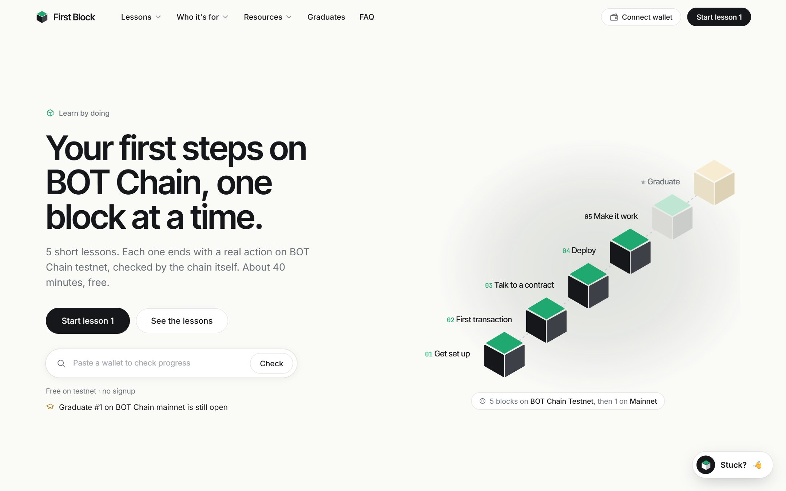

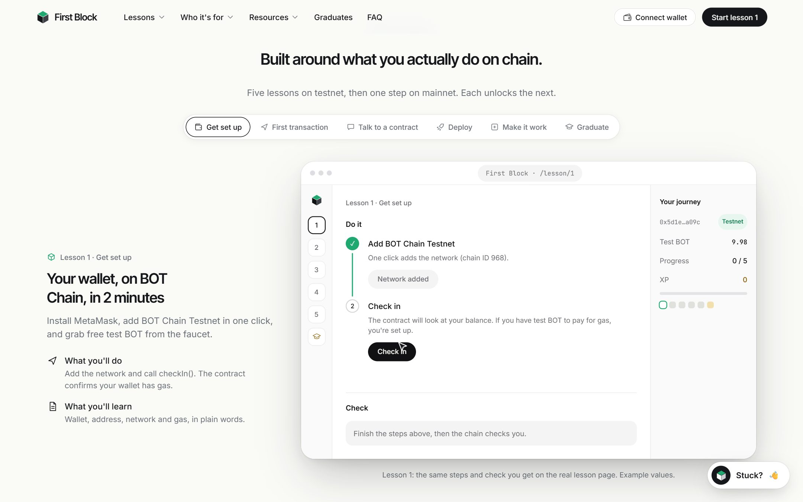

</div>

## Screenshots

App screens show a test wallet that passed all five lessons, before the Progress contract was redeployed clean. Its numbers are real, and the live contract starts from zero.

<table>
<tr>
<th width="50%">Your path</th>
<th width="50%">Learn</th>
</tr>
<tr>
<td>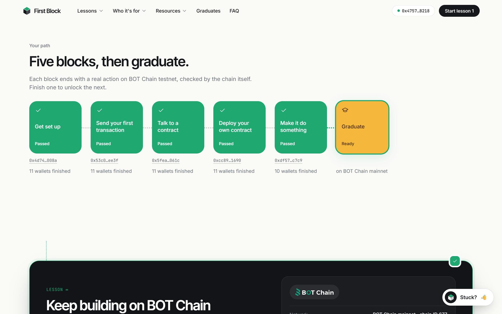</td>
<td>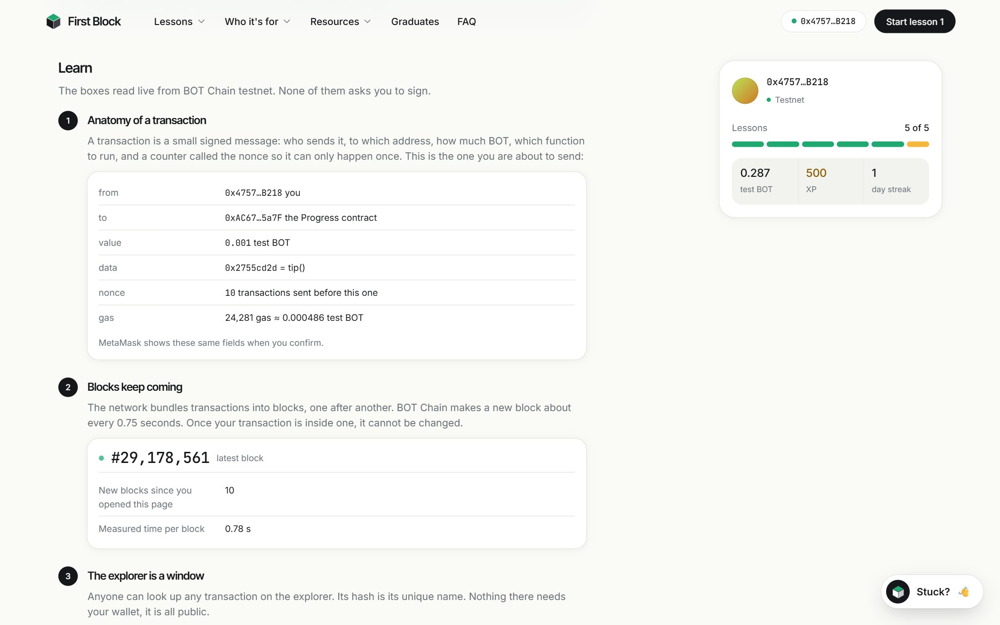</td>
</tr>
<tr>
<td>Five blocks, then graduate. Each block shows your transaction and how many wallets finished it.</td>
<td>Three short ideas per lesson, with boxes that read live from testnet. None of them asks you to sign.</td>
</tr>
<tr>
<th>You're about to sign</th>
<th>Reading is free</th>
</tr>
<tr>
<td>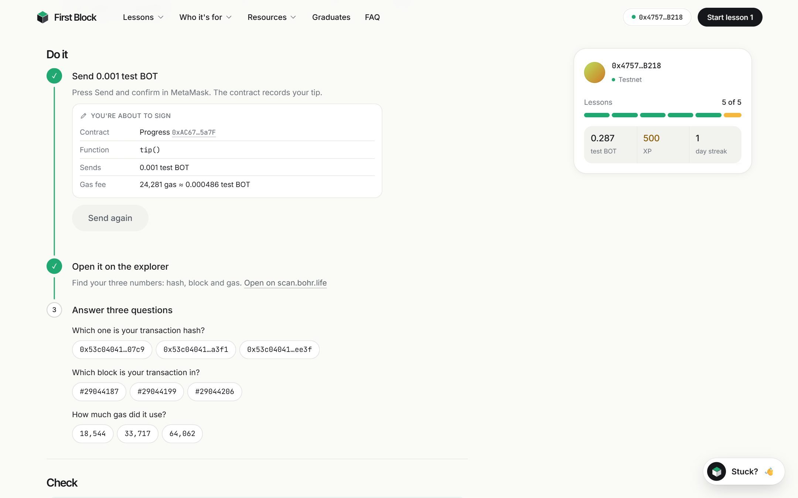</td>
<td>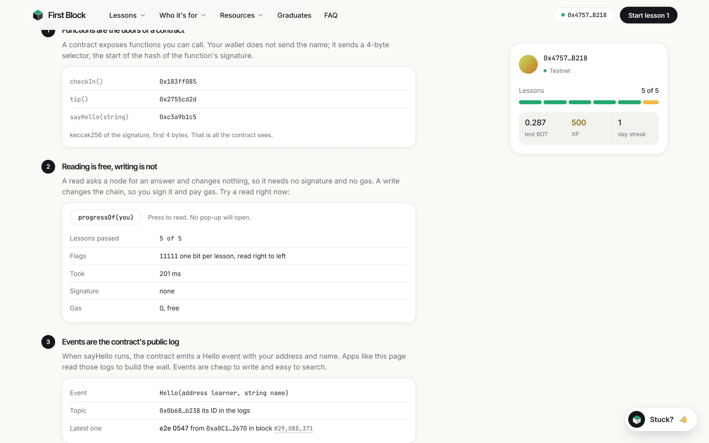</td>
</tr>
<tr>
<td>Before each transaction: the contract, the function, what you send and the estimated fee.</td>
<td>Press a button and call <code>progressOf(you)</code>. No pop-up, no signature, no gas.</td>
</tr>
<tr>
<th>What just happened</th>
<th>Deploy your own</th>
</tr>
<tr>
<td>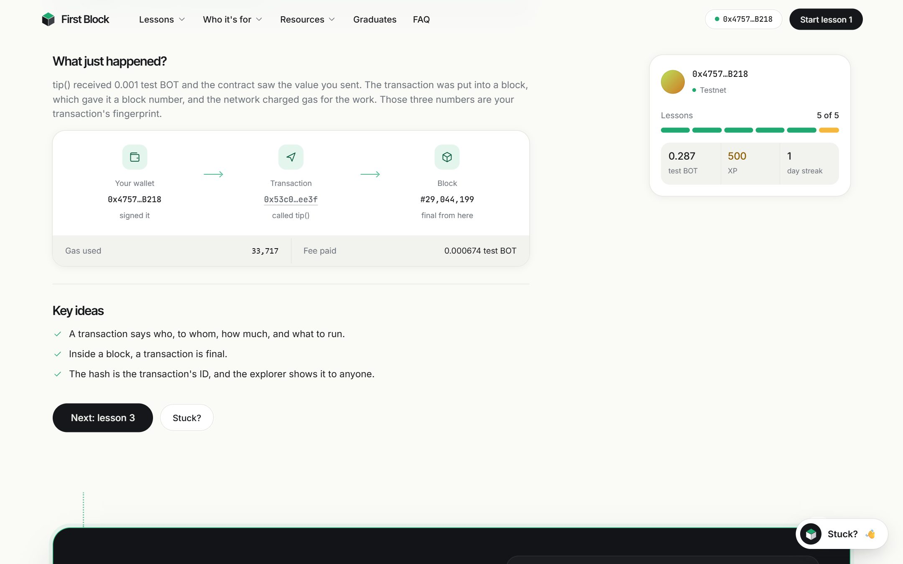</td>
<td>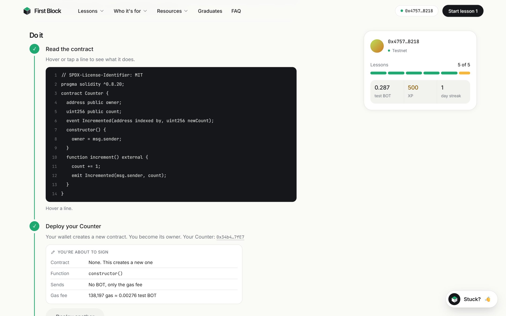</td>
</tr>
<tr>
<td>Your own wallet, transaction and block, with the gas and fee from the receipt, then the lesson's key ideas.</td>
<td>Read the Counter contract line by line, deploy it from your wallet, then submit it to be checked.</td>
</tr>
<tr>
<th>Graduate</th>
<th>The wall</th>
</tr>
<tr>
<td>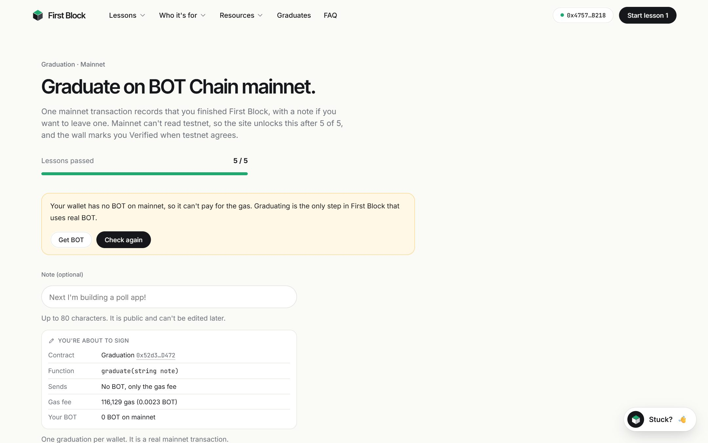</td>
<td>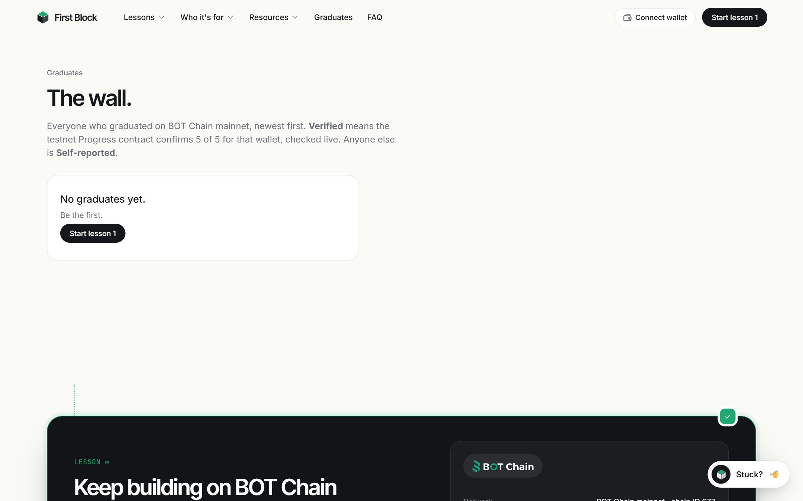</td>
</tr>
<tr>
<td>One mainnet transaction with an optional note. A wallet with no mainnet BOT sees why it can't continue.</td>
<td>Every graduate, read from the mainnet contract. No graduates yet.</td>
</tr>
</table>

<table>
<tr>
<th>Landing: how the checks work</th>
</tr>
<tr>
<td>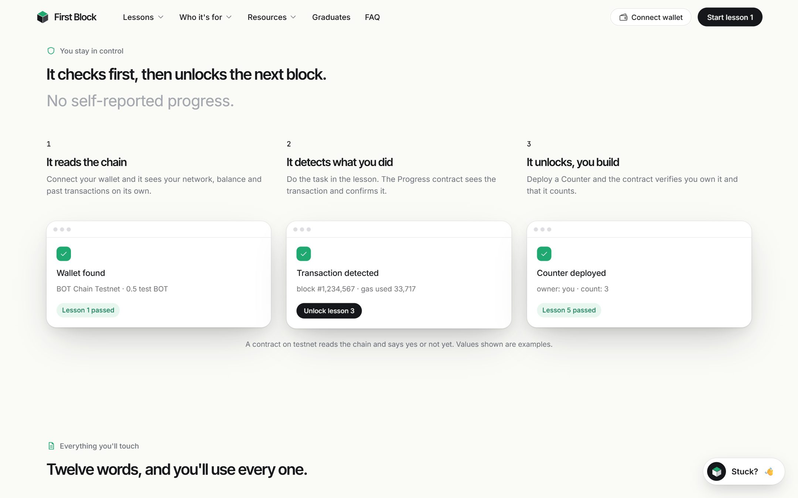</td>
</tr>
<tr>
<td>It reads the chain, detects what you did, and unlocks the next lesson. Values in this section are examples.</td>
</tr>
<tr>
<th>Landing: who it's for</th>
</tr>
<tr>
<td>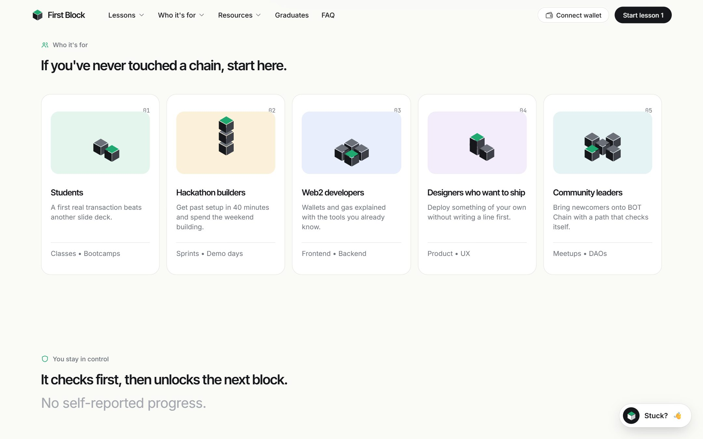</td>
</tr>
<tr>
<td>Students, hackathon builders, Web2 developers, designers who want to ship, and community leaders.</td>
</tr>
<tr>
<th>Landing: live hello wall and tools</th>
</tr>
<tr>
<td>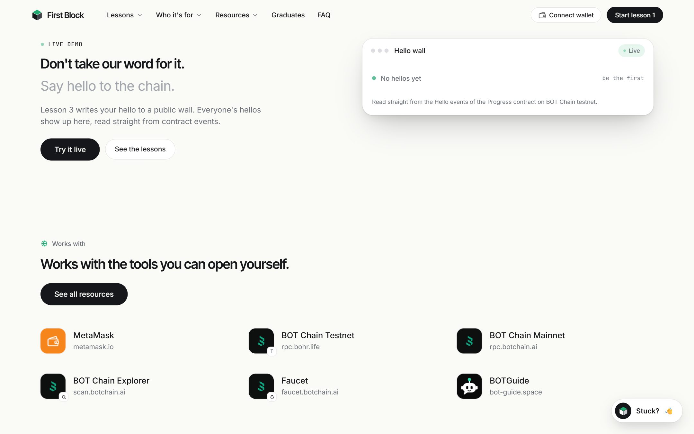</td>
</tr>
<tr>
<td>Hellos are read straight from contract events. Below them are the tools First Block works with.</td>
</tr>
</table>

## How it works

1. Connect MetaMask. There is no sign-up and no database. Lessons run on BOT Chain testnet, with free test BOT from the [faucet](https://faucet.botchain.ai/basic).
2. Each lesson teaches first: three short ideas, with live read-only data from the chain.
3. You do the action from your own wallet, with a summary of what you are about to sign.
4. The Progress contract checks the result and records the lesson. If it isn't met, the transaction reverts, and the page explains why in plain words.
5. The page shows what just happened, using your own hash, block, gas and fee.
6. After 5 of 5, you can graduate on mainnet with an optional note and get a card to share.
7. The wall reads every graduate from the mainnet contract and checks testnet live. A wallet with 5 of 5 shows **Verified**. Anyone else shows **Self-reported**.

**Lesson progress and graduation are on-chain. XP and day streaks stay in your browser.**

## The lessons

| # | Lesson | What you do | What the contract checks |
| --- | --- | --- | --- |
| 1 | Get set up | Add the network, get test BOT, check in | `checkIn()`: your wallet holds some BOT |
| 2 | Send your first transaction | Send 0.001 test BOT, then find your hash, block and gas | `tip()`: at least 0.001 test BOT was sent |
| 3 | Talk to a contract | Write your name to the wall | `sayHello(name)`: the name is 1 to 24 bytes, then a `Hello` event |
| 4 | Deploy your own contract | Deploy a Counter from your wallet and submit it | `submitCounter(c)`: the code hash matches and `owner()` is you |
| 5 | Make it do something | Press `increment()` three times | `finishCounter()`: your Counter's `count()` is at least 3 |
| 🎓 | Graduate | One transaction on mainnet, with an optional note | `graduate(note)`: once per wallet, up to 80 bytes |

Lessons 2 to 5 revert until the lesson before them has passed.

## Screens

| Route | What it is |
| --- | --- |
| `/` | Landing page: hero with a wallet check and the block path, lessons, who it's for, checks, glossary, live wall, graduates, FAQ |
| `/learn` | Your path: five blocks and Graduate, with your progress |
| `/lesson/1` to `/lesson/5` | Why it matters, Learn, Do it, Check, What just happened, Key ideas |
| `/graduate` | The mainnet graduation form and your card |
| `/wall` | Every graduate, with Verified or Self-reported |
| `/privacy`, `/terms` | What stays in your browser, what goes on chain, and the terms of this community project |

The hero's block path is six cubes, one per lesson plus graduation. Paste a wallet into the hero and they show that wallet's real progress, read from the Progress contract: grey is locked, light green is next, green has passed.

## Contracts

`FirstBlockProgress.sol` and `FirstBlockGraduation.sol` (Solidity 0.8.20, EVM `paris`, optimizer on with 200 runs, no tokens).

| Contract | Network | Chain ID | Address |
| --- | --- | --- | --- |
| FirstBlockProgress | BOT Chain Testnet | 968 | `0xAC67458c737AB0048193DA66512B8B418E355a7F` ([scan.bohr.life](https://scan.bohr.life/address/0xAC67458c737AB0048193DA66512B8B418E355a7F)) |
| FirstBlockGraduation | BOT Chain Mainnet | 677 | `0x52d3764C4300384f73E3E4Cd34bF942A5e60D472` ([scan.botchain.ai](https://scan.botchain.ai/address/0x52d3764C4300384f73E3E4Cd34bF942A5e60D472)) |

- **FirstBlockProgress:** the checks in the table above, plus the views `progressOf`, `counterOf` and `stats`. Its owner has one power: `sweep(to)` sends the test BOT from lesson 2 back out, for example to the faucet.
- **FirstBlockGraduation:** `graduate(note)`, plus the views `total`, `isGraduate`, `gradId` and `getGrads`. It has no owner, no admin functions and no payments.
- **Counter:** each learner deploys their own from the site. Bytecode is built without a metadata hash, so its code hash is the same wherever it is compiled. `public/counter.json` holds the bytecode and that hash.

The mainnet contract was deployed with the owner's own wallet through Remix. Its code was compared with this repo's build: the logic bytes are identical (2,486 bytes), and the only difference is the metadata hash Remix appends. 13 contract tests pass (`cd contracts && npx hardhat test`).

## Project layout

```
first-block/
  index.html    The landing page and the shell for every route
  src/          main.js (nav, landing, router), views.js (/learn, lessons), views2.js (/graduate, /wall),
                lessonApp.js (landing lesson preview), lessons.json (lesson text), chain.js, tx.js, live.js,
                xp.js, reveal.js, config.js (addresses and links), style.css
  public/       counter.json (Counter bytecode), logos
  contracts/    Hardhat project: Counter, FirstBlockProgress and FirstBlockGraduation, tests,
                scripts/ (make-wallet, export-counter, deploy-testnet, e2e-testnet), deployments/
  docs/shots/   README images
  vercel.json   Sends every route to index.html
```

## Run it locally

```bash
git clone https://github.com/Devs-GMT/first-block.git
cd first-block
npm install
npm run dev                     # http://localhost:5173
```

No environment variables are needed. The site reads its addresses from `src/config.js`. `VITE_MAINNET_CONTRACT` is optional and only overrides the mainnet address, for example to test against a simulated chain (see `.env.example`).

Run the contract tests:

```bash
cd contracts
npm install
npx hardhat test
```

Secrets live only in `contracts/.env`, which is git-ignored.

## Deploy

- **Site (Vercel):** import the repo. Vite is detected, and `vercel.json` sends every route to `index.html`. No environment variables are needed.
- **Your own Progress contract (testnet):**

```bash
cd contracts
node scripts/make-wallet.js     # writes a new TESTNET_KEY to contracts/.env and prints the address
```

Send that address some test BOT from the [faucet](https://faucet.botchain.ai/basic) (10 test BOT per address per 24 hours), then run:

```bash
npx hardhat run scripts/deploy-testnet.js --network botTestnet
```

The script writes `contracts/deployments/testnet.json`. Put the address and block in `TESTNET_PROGRESS` and `TESTNET_START_BLOCK` in `src/config.js`. If Node keeps resetting the RPC connection, set `NODE_OPTIONS=--dns-result-order=ipv4first` first.

## Mainnet

The Graduation contract is live at [`0x52d3764C4300384f73E3E4Cd34bF942A5e60D472`](https://scan.botchain.ai/address/0x52d3764C4300384f73E3E4Cd34bF942A5e60D472). To deploy your own copy:

1. Open `contracts/contracts/FirstBlockGraduation.sol` in Remix. Compiler `0.8.20`, EVM version `paris`, optimizer on (200 runs). No constructor arguments.
2. Deploy with your wallet on BOT Chain Mainnet (chain ID 677, RPC `https://rpc.botchain.ai`).
3. Put the address in `MAINNET_CONTRACT` in `src/config.js` and redeploy the site.

## Limits, said plainly

- **Mainnet can't read testnet.** The site only offers graduation after 5 of 5, but anyone can call `graduate()` directly. That is why the wall checks testnet live and shows Verified or Self-reported. If the testnet RPC can't be reached, an entry shows Self-reported until the next successful read.
- **A pass shows that a wallet did the action, not that a person understood it.** The lesson 2 questions aren't checked on chain.
- **Lesson 5 proves the count, not who pressed.** `increment()` is open to anyone, so another wallet could raise your Counter.
- **Lesson 1 only checks for a balance above zero.**
- **XP and day streaks live in your browser.** They can be cleared or edited, and they don't count as proof.
- **Your name in lesson 3 and your note on mainnet are public and permanent.** Use a nickname if you prefer.
- **The Stuck helper answers from a fixed list.** It is not an AI.
- **Testing:** the full browser run passed 34 of 34 checks, on the real testnet for the lessons and a simulated chain 677 for graduation, using an injected test wallet. That script isn't in this repo. The run happened before the clean Progress redeploy, which uses the same code. Graduation has not been sent through the site on the real mainnet yet.

## Who is First Block for?

1. **Students:** a first real transaction beats another slide deck.
2. **Hackathon builders:** get past setup quickly and spend the weekend building.
3. **Web2 developers:** wallets and gas, explained with the tools you already know.
4. **Designers who want to ship:** deploy something of your own without writing a line first.
5. **Community leaders:** bring newcomers onto BOT Chain with a path that checks itself.

## Roadmap

| Version | Features |
| --- | --- |
| **MVP (V1)** | Five lessons checked on testnet, Learn sections, sign previews, mainnet graduation, shareable card, graduates wall |
| Next | Not decided yet |

Only the MVP (V1) is built today.

## Important notes

- First Block never asks for your recovery phrase. Never share it with anyone.
- Test BOT has no value. Lessons 1 to 5 can't cost you real money. Graduation uses a little real BOT for gas.
- First Block is a community project, not official BOT Chain education. If it disagrees with the [official docs](https://dev-docs.botchain.ai/docs/intro), the official docs are right.
